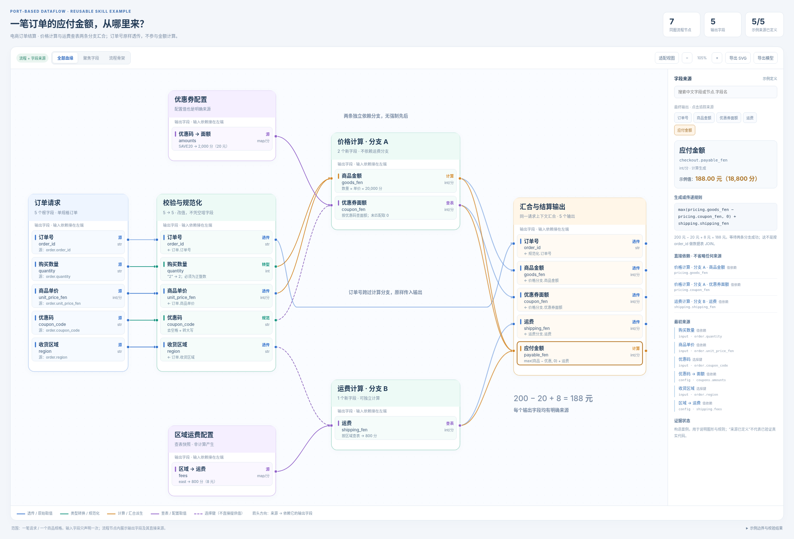

# port-lineage-diagram

把非线性流程和字段来源画在同一张端口式数据流图中。

包中包含 `SKILL.md`、纯 Python 构建器、离线 SVG/HTML 查看器、两份可运行示例和校验脚本。
不是图片提示词，也不是只能画订单的固定页面。

## 先看效果



打开 `examples/order-checkout/index.html`。
默认案例：订单校验后分成价格与运费两条独立依赖分支，再汇合产生 5 个输出。
点击“订单号”“运费”“应付金额”对比透传、查表与多来源计算。

`examples/file-import/index.html` 是第二个通用案例，仅更换模型，采用自动布局。
图片在各示例 `qa/` 下：`overview.png`、`focus.png`、`diagram.png`、`mobile.png`。
SVG 可直接编辑，HTML 不依赖 CDN、外部字体、后端服务或运行中的 Python。
手机 / 聊天客户端的 HTML 预览可能不执行脚本；交互功能需在支持 JavaScript 的正常浏览器中打开。

## 作为 Agent Skill 使用

把整个 `port-lineage-diagram` 文件夹放入所用 Agent 支持的 skills 目录，保持 `SKILL.md` 位于文件夹根目录。
Skill 的发现路径、热加载与调用语法由客户端决定；本包不自动安装、注册或修改任何本地配置。

将下面的请求交给已加载 Skill 的 Agent：

> 使用 port-lineage-diagram，把这个项目的数据处理流程和字段来源画在同一张图中。保留分支、汇合、透传和配置来源；显示中文含义；只画目标输出所必需的字段；未知来源不要猜。输出离线 HTML、SVG 和真实浏览器 PNG。

也可直接让 Agent 读取本目录 `SKILL.md` 后执行，不依赖自动触发。

## 独立运行

核心构建只需要 Python 3.10+，无第三方 Python 库。

```bash
cd port-lineage-diagram
python scripts/lineage.py build examples/order-checkout.json --out output/checkout --strict
python scripts/lineage.py trace examples/order-checkout.json checkout.payable_fen
python -m unittest discover -s tests -v
```

将自己的范围、节点和直接字段依赖写成 JSON，再运行相同构建命令。
契约见 `references/model-contract.md`。

构建输出为：

```text
output/checkout/
├── index.html
├── diagram.svg
├── model.json
└── validation.json
```

HTML 已内嵌模型、SVG、样式和交互，拷贝单个 HTML 文件即可阅读。

## PNG 和浏览器验收

已有 Playwright 与本地 Chromium 时运行：

```bash
python scripts/browser_qa.py output/checkout/index.html --out output/checkout/qa
# 浏览器不在常见路径时：
python scripts/browser_qa.py output/checkout/index.html --out output/checkout/qa --browser /path/to/chromium
```

脚本不联网安装依赖或浏览器。无法使用浏览器时会明确失败，不伪造截图。
它把自包含 HTML 加载进浏览器并生成截图；当前打包环境采用 `set_content` 加载，未使用 file URL 导航。

## 范围与限制

这是绘图与来源表达工具，不是业务执行引擎，不会运行 JSON 的 rule，不会自动从任意语言源代码抽取准确血缘。
没有无条件的数据环支持；迭代值应版本化后展示。控制回边不等于执行了重试。
自动布局适合小中型图，复杂图仍需微调位置与走线，且必须看实际截图。
来源已定义 ≠ 来源已由真实项目代码验证。
本包没有宣称严格兼容 OpenLineage/PROV/UML 的交换格式。

## 结构格式依据

Skill 目录使用 Agent Skills 的 `SKILL.md` frontmatter 与 `scripts / references / assets` 结构。
官方规范：<https://agentskills.io/specification>（核对日期：2026-10-19）。

本图样式从用户已选定的第一种“端口式 Dataflow”整理而来。业务数据改为构造的订单与文件导入案例；未打包旧医疗样例或原项目资料。

## 版本与发布

当前版本：`1.0.0`。首个发布标签：`v1.0.0`。

- [版本变更](CHANGELOG.md)
- [Release 说明](RELEASE-NOTES.md)
- [维护者发布步骤](PUBLISHING.md)
- [本地发布前检查](PUBLICATION-CHECK.md)

当前仓库内容未附加新的开源许可证；公开可见性和许可证选择分别处理。
